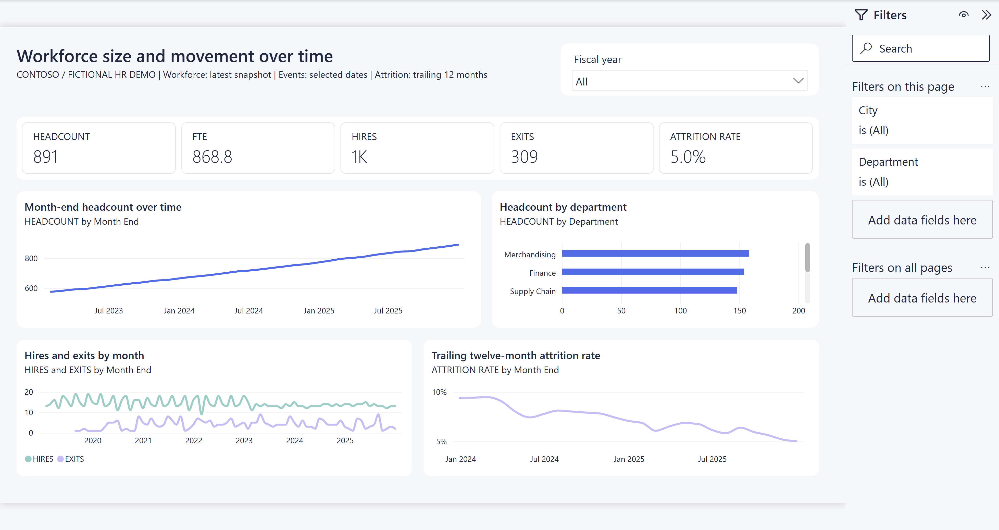
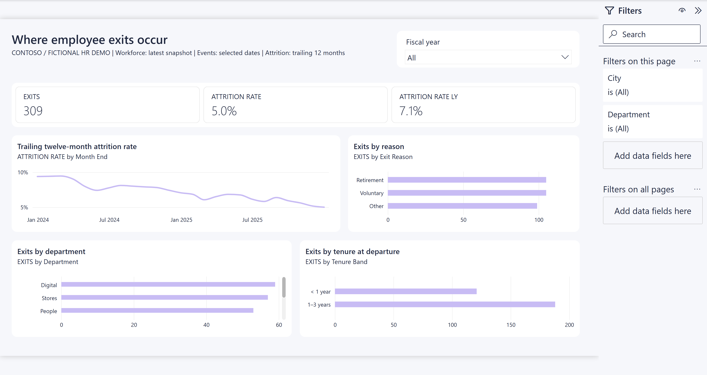
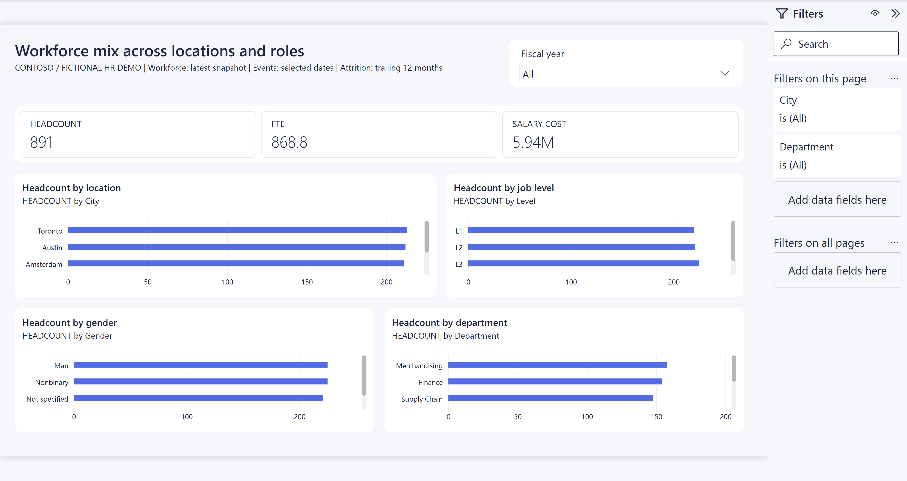

# HR demo report

## Overview

The local [`hr.pbip`](../../src/hr.pbip) opens the [`hr.Report`](../../src/hr.Report) project against the co-located [`hr.SemanticModel`](../../src/hr.SemanticModel). It is designed to introduce a fictional workforce example to HR colleagues. It is not a view of actual employees, salaries or attrition policy.

The report uses the [Contoso theme](../../src/hr.Report/StaticResources/RegisteredResources/Contoso.json) on three 1280 x 720 pages. Charts reference theme colors rather than hard-coded hex colors. Each page has one fiscal-year dropdown slicer. Department and location are available in the filter pane. Charts cross-filter other visuals on the page.

| Property | Value |
|---|---|
| Source | `src/hr.Report` |
| Semantic model | [hr](./hr.semantic-model.md), bound by relative path |
| Pages | 3 |

## Report Flow

Start with workforce size and movement to compare the latest workforce snapshot with hiring, exits and attrition trends. Move to the exits page to explore reasons, departments and tenure at departure. Use the workforce mix page to compare the latest snapshot across locations and employee groups.

## Pages

| Page | Purpose | Visuals |
|---|---|---|
| Workforce size and movement over time | Establish workforce size and change over time. | Compact cards for headcount, FTE, hires, exits and attrition; monthly headcount, hires versus exits, trailing attrition, and headcount by department. |
| Where employee exits occur | Explore the volume, rate and composition of exits. | Cards for exits, trailing attrition and prior-year attrition; monthly attrition, and exits by reason, department and tenure band. |
| Workforce mix across locations and roles | Compare current workforce composition. | Cards for headcount, FTE and estimated monthly salary cost; headcount by city, level, gender and department. |

Headcount, FTE and salary cost use the latest month-end snapshot within the selected dates. Hires and exits count events in the selected dates. Attrition uses the trailing 12 complete snapshot months. Rates and headcount totals recalculate rather than sum monthly values. The calendar follows an illustrative February to January fiscal year. All salary figures are synthetic currency units, not actual payroll.

### Workforce size and movement over time

This page introduces workforce size and how it changes. In the captured all-years view, the cards show 891 employees, 868.8 FTE, hires rounded to 1K, 309 exits and 5.0% trailing attrition. These are illustrative snapshot values, not fixed targets.

#### Main Metrics

- **HEADCOUNT and FTE**: Employees and full-time-equivalent capacity at the latest selected snapshot.
- **HIRES and EXITS**: Movement counts across the selected dates, not just the latest snapshot month.
- **ATTRITION RATE**: Trailing twelve-month exits divided by average monthly headcount over the same complete snapshot months.

#### Analysis Breakdowns

Monthly charts compare headcount, hires versus exits, and trailing attrition. The department chart compares latest-snapshot headcount. The all-years capture includes movement history before the 2023 to 2025 snapshot range, so the movement chart covers more years than the headcount chart. The department chart has a scrollbar for additional categories.

#### Available Filters

| Scope | Filter or slicer | Captured state |
|---|---|---|
| Page | Fiscal year dropdown, `Calendar[Fiscal Year]` | All |
| Page filter pane | City, `Location[City]` | All |
| Page filter pane | Department, `Department[Department]` | All |

#### Interactions and Navigation

Use the fiscal-year slicer and page filters to narrow the analysis. Chart selections use standard Power BI interactions; their filtering effects were not tested during capture. Use the report page tabs to move to exits or workforce mix.

### Where employee exits occur

This page separates exit volume from attrition rate and explores where departures occur. The captured cards show 309 exits, 5.0% trailing attrition and 7.1% prior-year trailing attrition.

#### Main Metrics

- **EXITS**: Departures in the selected dates.
- **ATTRITION RATE and ATTRITION RATE LY**: The current trailing rate and the equivalent rate at the corresponding date a year earlier. These are not sums of monthly percentages.

#### Analysis Breakdowns

The line chart shows trailing attrition by month. Bar charts compare exits by reason, department and tenure band at departure. The captured reasons are Retirement, Voluntary and Other. The department chart scrolls to additional departments. Exit counts alone do not establish which department has the highest attrition rate.

#### Available Filters

| Scope | Filter or slicer | Captured state |
|---|---|---|
| Page | Fiscal year dropdown, `Calendar[Fiscal Year]` | All |
| Page filter pane | City, `Location[City]` | All |
| Page filter pane | Department, `Department[Department]` | All |

#### Interactions and Navigation

Use page filters to compare exit patterns for a city or department. Chart selection effects and scrolling were not tested during capture. Use page tabs to return to workforce trends or continue to workforce mix.

### Workforce mix across locations and roles

This page compares the composition and estimated monthly salary cost of the latest selected workforce snapshot. The captured cards show 891 employees, 868.8 FTE and salary cost rounded to 5.94M synthetic currency units.

#### Main Metrics

- **HEADCOUNT and FTE**: Latest-snapshot workforce size and full-time-equivalent capacity.
- **SALARY COST**: Annual base salary multiplied by FTE and divided by 12, summed at the latest selected snapshot. It is a monthly estimate, not accumulated payroll across all selected years.

#### Analysis Breakdowns

Bar charts compare headcount by city, job level, fictional gender and department. Scrollbars indicate that more categories exist than are visible in the image; the screenshot is not a complete category listing.

#### Available Filters

| Scope | Filter or slicer | Captured state |
|---|---|---|
| Page | Fiscal year dropdown, `Calendar[Fiscal Year]` | All |
| Page filter pane | City, `Location[City]` | All |
| Page filter pane | Department, `Department[Department]` | All |

#### Interactions and Navigation

Use the slicer and page filters to narrow the snapshot comparison. Chart selection effects and scrolling were not tested during capture. Use page tabs to return to workforce trends or exit analysis.

## Global Filters and Navigation

The saved report has no report-level filters, bookmarks or custom navigation buttons. The captured filter pane is expanded on every page and shows City and Department as All, with no filters on all pages. Each page has its own fiscal-year slicer; do not assume a selection carries across pages. Navigation uses the standard report page tabs, which are outside the captured report area.

## Authoring and verification

Earlier authoring validation reported zero PBIR errors and warnings, no geometry overlaps or canvas overflow, and populated month, department, location, level, gender, exit-reason and tenure groups from DEV model queries. Those checks were not repeated for this documentation update. The previously documented report generator is absent from the current worktree; the saved PBIR under `src/hr.Report` is the available source. The report files are local only and have not been published by this workflow.

### Screenshot inspection, 2026-11-01

All three pages were captured from Power BI Desktop through `powerbi-report-author preview` with `--host desktop --all-pages` and reviewed. The images include the expanded filter pane. Cards show values, charts show populated lines and bars, and there are no visible visual error messages. Each saved page has seven visuals, including one slicer, within the team limits of one slicer and 20 visuals.

These screenshots replace the previous capture limitation. The CLI reported `LIVE_WINDOW_NOT_RELOADED`: it captured the current Desktop window without reloading the saved PBIR or semantic model. Saved metadata remains authoritative for bindings and calculations; the images illustrate the current rendered experience. This does not verify that every unsaved or on-disk change is loaded, and does not complete the spec's latest-source rendering acceptance check.

**Not verified:** Interactive filtering, cross-filtering, page-to-page slicer behavior, tooltip behavior, scrolling through all categories, service rendering, and agreement between the current window and all saved definitions. No deployment, refresh, model queries or new schema validation ran for this documentation update.

**Noticed, not changed:** Several category charts require scrolling, so not every category is visible at once. Chart subtitles repeat their metric and grouping. No report design changes were made.
