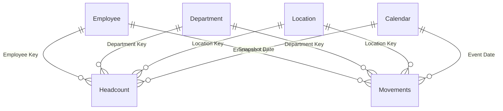

# HR demo semantic model

## Overview

The `hr` semantic model supports a fictional workforce briefing for the HR team. It uses deterministic sample records and does not contain real employee data. Salary and gender are invented; neither the rates nor salary totals should be interpreted as company HR figures.

| Property | Value |
|---|---|
| Source | [`src/hr.SemanticModel`](../../src/hr.SemanticModel) |
| Storage | Import, generated in Power Query without an external source |
| Tables | 6 |
| Measures | 9 |
| Relationships | 8 |
| DEV model | `hr` in `RR - PBI Factory {dev}` |

## Model structure

All relationships filter one way from a dimension to a fact. `Employee` has 1,200 fictional profiles with static department and location assignments. `Department` has six rows; `Location` has five. `Calendar` contains every day from 2019-01-01 to 2025-12-31 and a February to January fiscal year. `Headcount` contains one row per employed employee at each month end from January 2023 through December 2025. `Movements` contains one row per hire or exit, including older events used to explain employee tenure. Fact foreign keys and aggregation-only numeric columns are hidden.

## Measures

| Home table | Measure | Meaning |
|---|---|---|
| Headcount | `HEADCOUNT` | Distinct employees at the latest available snapshot within selected dates. A period total is the closing snapshot, not the sum of months. |
| Headcount | `FTE` | Sum of full-time equivalent weights at that closing snapshot. |
| Headcount | `AVERAGE HEADCOUNT` | Mean of available month-end headcounts in the selected months. |
| Headcount | `SALARY COST` | Illustrative monthly base-salary cost: annual base salary times FTE divided by 12 at the closing snapshot. Benefits and taxes are excluded. Values are synthetic currency units. |
| Headcount | `HEADCOUNT LY` | Headcount at the corresponding month end one year earlier. |
| Movements | `HIRES` | Count of hire events in selected dates. |
| Movements | `EXITS` | Count of exit events in selected dates. Exit reason and tenure band apply only to exits. |
| Movements | `ATTRITION RATE` | Exits over the trailing 12 complete months divided by average monthly headcount in those same months; blank without 12 snapshots or positive headcount. |
| Movements | `ATTRITION RATE LY` | The trailing attrition rate as of the corresponding month end one year earlier. |

The synthetic demo definitions are specified in the [HR demo spec](../specs/hr-demo-202610.md). These are not verified HR policy. Gender, fictional names and salary are not protected by a role; do not replace this sample with actual employee data without a security design.

## Data sources, refresh and validation

`EmployeeRows` is a deterministic Power Query expression. The Import partitions use that roster to generate the snapshot and movement rows without network access. The model is saved as local TMDL and was deployed to DEV via the Power BI model authoring tool, then fully refreshed through XMLA. The model loaded and all 14 live `Tests.Run` assertions returned boolean true. Live checks found 1,200 employees, six departments, five locations, 2,557 calendar dates, 26,123 snapshot rows, 1,509 events, 36 distinct snapshot months and no duplicate dimension keys. There were no unmatched employee foreign keys. At 2025-12-31, headcount was 891 and trailing attrition was approximately 5.02%. The monthly headcount reconciliation passed for all 35 transitions.

The Windows-only BPA was not run in this Linux environment. `scripts/test-data.py` and `scripts/refresh.py` were not run because `.env`, Fabric CLI and Azure CLI are unavailable here; equivalent live `Tests.Run` and XMLA full-refresh checks were completed with the model authoring tool. No report has been built or published.
