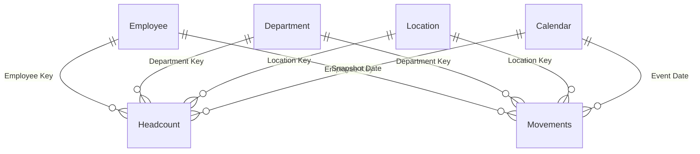

# HR demo semantic model

## Overview

The `hr` semantic model supports a fictional workforce briefing for the HR team. It uses deterministic sample records and does not contain real employee data. Salary and gender are invented; neither the rates nor salary totals should be interpreted as company HR figures.

| Property | Value |
|---|---|
| Source | [`src/hr.SemanticModel`](../../src/hr.SemanticModel) |
| Storage | Import, generated in Power Query without an external source |
| Tables | 6 |
| Measures | 9 |
| Relationships | 8 |
| DEV model | `hr` in `RR - PBI Factory {dev}` |

## Model structure



All relationships filter one way from a dimension to a fact. `Employee` has 1,200 fictional profiles with static department and location assignments. `Department` has six rows; `Location` has five. `Calendar` contains every day from 2019-01-01 to 2025-12-31 and a February to January fiscal year. `Headcount` contains one row per employed employee at each month end from January 2023 through December 2025. `Movements` contains one row per hire or exit, including older events used to explain employee tenure. Fact foreign keys and aggregation-only numeric columns are hidden.

## Measures

| Home table | Measure | Meaning |
|---|---|---|
| Headcount | `HEADCOUNT` | Distinct employees at the latest available snapshot within selected dates. A period total is the closing snapshot, not the sum of months. |
| Headcount | `FTE` | Sum of full-time equivalent weights at that closing snapshot. |
| Headcount | `AVERAGE HEADCOUNT` | Mean of available month-end headcounts in the selected months. |
| Headcount | `SALARY COST` | Illustrative monthly base-salary cost: annual base salary times FTE divided by 12 at the closing snapshot. Benefits and taxes are excluded. Values are synthetic currency units. |
| Headcount | `HEADCOUNT LY` | Headcount at the corresponding month end one year earlier. |
| Movements | `HIRES` | Count of hire events in selected dates. |
| Movements | `EXITS` | Count of exit events in selected dates. Exit reason and tenure band apply only to exits. |
| Movements | `ATTRITION RATE` | Exits over the trailing 12 complete months divided by average monthly headcount in those same months; blank without 12 snapshots or positive headcount. |
| Movements | `ATTRITION RATE LY` | The trailing attrition rate as of the corresponding month end one year earlier. |

The synthetic demo definitions are specified in the [HR demo spec](../specs/hr-demo-202610.md). These are not verified HR policy. Gender, fictional names and salary are not protected by a role; do not replace this sample with actual employee data without a security design.

## Data sources, refresh and validation

`EmployeeRows` is a deterministic Power Query expression. The Import partitions use that roster to generate the snapshot and movement rows without network access. The model is saved as local TMDL and was deployed to DEV via the Power BI model authoring tool, then fully refreshed through XMLA. The model loaded and all 14 live `Tests.Run` assertions returned boolean true. Live checks found 1,200 employees, six departments, five locations, 2,557 calendar dates, 26,123 snapshot rows, 1,509 events, 36 distinct snapshot months and no duplicate dimension keys. There were no unmatched employee foreign keys. At 2025-12-31, headcount was 891 and trailing attrition was approximately 5.02%. The monthly headcount reconciliation passed for all 35 transitions.

The Windows-only BPA was not run in this Linux environment. `scripts/test-data.py` and `scripts/refresh.py` were not run because `.env`, Fabric CLI and Azure CLI are unavailable here; equivalent live `Tests.Run` and XMLA full-refresh checks were completed with the model authoring tool. The `hr` report is documented separately and remains local; it has not been published.

## Copilot readiness

Visible tables, columns and measures now have descriptions. The existing table descriptions clarify each table's purpose and grain. Geographic categories identify the city and country fields for fictional workforce hubs. All HR content is synthetic; it is not actual employee data, payroll, demographics or verified HR policy.

The recommendations follow Microsoft's [Copilot model optimization](https://learn.microsoft.com/power-bi/create-reports/copilot-evaluate-data) and [AI instructions](https://learn.microsoft.com/power-bi/create-reports/copilot-prepare-data-ai-instructions) guidance. Prep data for AI is configured in Power BI and is not stored in these local TMDL definitions.

Use these draft instructions in Power BI's **Prep data for AI** only after review by the model owner:

```text
Data scope
- This is a fictional HR demo with synthetic employee, gender, salary, department, location and movement data. Do not present it as actual workforce information, payroll, demographics or HR policy.

Dates and headcount
- The demo fiscal year runs February through January; this is not confirmed HR policy.
- HEADCOUNT and FTE use the latest selected month-end snapshot. A period total is the closing snapshot, not a sum of monthly values.
- AVERAGE HEADCOUNT averages the available month-end snapshots in the selected period.

Movements and attrition
- HIRES and EXITS count event rows by the selected event date.
- ATTRITION RATE is exits in the trailing 12 complete months divided by average monthly headcount for those same months. It is blank without 12 snapshots or positive headcount.
- Use HEADCOUNT for workforce size, not a count of employee dimension rows.
```

In the AI data schema, include the described business measures and fields required for workforce trends, department, location, movement type, exit reason and tenure analysis. Keep the synthetic-data caveat prominent. Do not treat hidden keys or fields as security controls. Avoid creating verified answers until the model owner confirms the expected results against the live model and Copilot.

| Copilot test question | Expected model interpretation |
|---|---|
| What was headcount by department at December 2025 month end? | `Headcount[HEADCOUNT]` by `Department[Department]`, at the 2025-12-31 snapshot. |
| What were hires and exits by month in calendar year 2025? | `Movements[HIRES]` and `[EXITS]` by `Calendar[Month End]`, filtered by the 2025 event dates. |
| What was the attrition rate as of December 2025? | `Movements[ATTRITION RATE]`, using the trailing 12 complete months and average monthly headcount. |
| What was salary cost by location at December 2025 month end? | `Headcount[SALARY COST]` by `Location[City]`, at the closing snapshot; state that all values are synthetic demo data. |

These are test cases, not verified Copilot answers. Workspace **Prep data for AI** settings and live Copilot responses were not available during this local TMDL change.

The metadata changes were deployed to `RR - PBI Factory {dev}` on 2026-11-02. `python scripts/test-data.py` passed all 14 HR assertions and all 36 sales assertions after deployment. No refresh was run because only descriptions and geographic categories changed. Live Copilot responses remain unverified.
