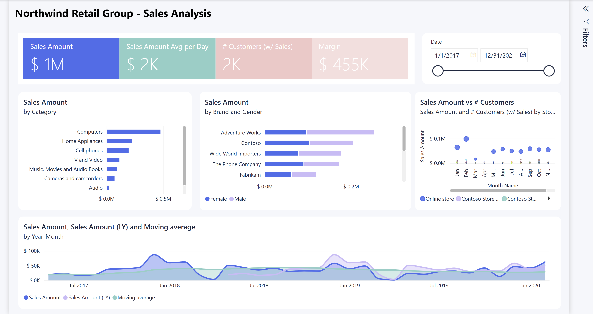
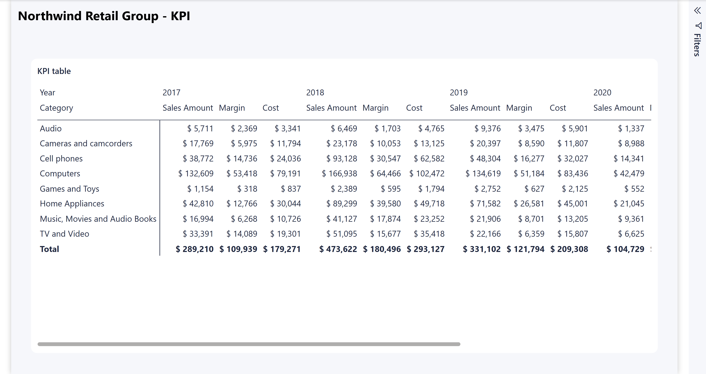

# sales-overview

## Overview

This report presents Northwind Retail Group sample sales analysis for retail analysts and business users. It moves from headline sales and customer metrics to product mix, store comparisons and trends, then to a category-by-year matrix of sales, margin and cost.

| Property | Value |
|---|---|
| Source | `src/sales-overview.Report` |
| Project entry point | `src/sales-overview.pbip` |
| Semantic model | [sales](sales.semantic-model.md), via `../sales.SemanticModel` |
| Pages | 2 |
| Visuals | 9: seven on Sales, two on KPI |
| Theme | Registered Contoso theme over Fluent2-CY26SU08 |

Amounts are sample calculations, not certified revenue. The model randomizes quantities and net prices at refresh and does not convert currencies. Dollar formatting does not establish the reporting currency.

## Report Flow

1. **Sales**, the saved active page, provides four headline metrics and an on-page date-range slicer. Compare category and brand performance, inspect monthly store patterns, and review sales against prior-year sales and a moving average.
2. **KPI** provides an annual financial matrix by product category. Use it to compare sales, monetary margin and cost across years.

Use the standard report page selector to move between pages. No custom navigation buttons, bookmark groups or drillthrough destinations are defined.

## Pages

### Sales



The page combines a summary strip, date selector, two product breakdowns, a store/month bubble chart and a full-width time trend. The captured view has populated visuals, a collapsed filter pane and a visible date range of January 1, 2017 to December 31, 2021. These are capture-time observations, not a saved categorical filter selection or a promise of sales on every date.

#### Main Metrics

| Metric | Business meaning and presentation |
|---|---|
| Sales Amount | Card showing the sum of sales-line quantity multiplied by net unit price. |
| Sales Amount Avg per Day | Card averaging nonblank daily sales results, not every day in the selected range. |
| # Customers (w/ Sales) | Card counting distinct customer keys in filtered sales, not all customer records. |
| Margin | Card showing sales-line quantity multiplied by net price less unit cost. It is an amount, not a percentage or net profit. |
| Sales Amount (LY) | Trend comparison against the same date period one year earlier, shown only where current sales are positive. |
| Moving average | Trend-only visual calculation over Sales Amount; distinct from the semantic model's rolling daily-average measures. |

See the [semantic model measure definitions](sales.semantic-model.md#measures) for DAX, filter behavior and currency caveats.

#### Analysis Breakdowns

| Visual | Fields and analysis |
|---|---|
| Category bar chart | Sales Amount by Product.Category, descending by sales. Additional drill levels are Product.Subcategory and Product.Product. |
| Brand stacked bar chart | Sales Amount by Product.Brand, split by Customer.Gender and sorted descending by sales. Product.Product is an additional drill level. |
| Store/month bubble chart | Calendar.Month Name on X, Sales Amount on Y, Store.Store as the series and # Customers (w/ Sales) as bubble size. |
| Area trend | Calendar.Year-Month in ascending order, with Sales Amount, Sales Amount (LY) and Moving average. |

The bubble chart title says **Sales Amount vs # Customers**, but customers determine bubble size, not the X axis. Month Name combines the same month across selected years rather than identifying a particular year-month. Month Name is sorted by the model's Month number.

The trend's native visual calculation is:

```dax
MOVINGAVERAGE([Sales Amount], 12)
```

This smooths Sales Amount across a 12-row visual window. With one displayed row per year-month, it is a moving average of displayed monthly sales values, not a trailing average of daily values. The expression supplies no custom edge or blank handling. Its window follows the visual result and should not be assumed to contain 12 complete calendar months if rows are missing. Neither Sales Amount (6M average) nor Sales Amount (12M average) is bound to this report.

#### Available Filters

| Scope | Filter or slicer | Behavior / default |
|---|---|---|
| On-page slicer | Calendar.Date | Date-range selector with inputs and slider in the capture; no explicit saved range predicate in the inspected definition. Filters sales through Order Date. |
| Page | Calendar.Year | Categorical filter card; no selected-value predicate saved. |
| Page | Product.Category | Categorical filter card; no selected-value predicate saved. |
| Page | Product.Subcategory | Categorical filter card; no selected-value predicate saved. |
| Page | Store.Store | Categorical filter card; no selected-value predicate saved. |
| Visual, brand chart | Calendar.Year | Additional categorical filter card for that chart; no selected-value predicate saved. |

The filter pane is enabled but initially collapsed. Expand it to use the page filter cards. A filter card without a saved predicate exposes a field without imposing a documented selection.

#### Interactions and Navigation

The category chart supports Category > Subcategory > Product drill levels. The brand chart supports Brand > Product. Visuals enable filtering of other visuals during drill, consistent with the report setting.

Cross-highlighting is not globally disabled, and no explicit interaction overrides were found. Selections can use standard Power BI visual interactions, but each selection/drill result was not exercised during documentation. There are no custom tooltip pages, bookmark actions or drillthrough definitions. Enhanced standard tooltips are enabled.

The screenshot shows chart scrollbars and truncated store labels, a truncated bubble-chart subtitle and abbreviated month labels. Use scrolling, tooltips or a larger view where needed. These existing presentation limitations were not changed.

### KPI



This page contains a heading and one matrix titled **KPI table**. It supports a detailed financial comparison across product categories and calendar years. It does not contain target-based KPI indicators or variance-to-target calculations.

#### Main Metrics

| Metric | Business meaning and presentation |
|---|---|
| Sales Amount | Monetary sales-line total for each category/year intersection. |
| Margin | Monetary sales-line margin for each category/year intersection, not a percentage. |
| Cost | Sales-line quantity multiplied by sales-line unit cost for each category/year intersection. |

The captured matrix contains populated category rows and a total row. Dollar amounts are formatted to whole units.

#### Analysis Breakdowns

The matrix uses Product.Category as rows, Calendar.Year as columns, and Sales Amount, Margin and Cost as values. It provides annual comparisons rather than monthly or fiscal-year analysis.

The matrix exceeds the visible width. Horizontal scrolling is required to see later columns; the screenshot does not show the complete matrix. No additional matrix drill levels are defined.

#### Available Filters

| Scope | Filter or slicer | Behavior / default |
|---|---|---|
| Report | None defined | No report-level filter predicates were found. |
| Page | None defined | No KPI page filters or on-page slicers were found. |
| Visual | None defined | No explicit matrix filter predicates were found. |

The Sales date slicer has no saved synchronization configuration. Do not assume its selection applies on KPI.

#### Interactions and Navigation

Use the standard page selector to return to Sales. The matrix supports normal selection, scrolling and standard tooltips. There are no custom buttons, bookmarks or drillthrough actions.

## Global Filters and Navigation

No report-level filter definitions, bookmarks, custom navigation actions, synchronized slicer configuration or hidden pages were found. Saved page order is Sales then KPI, with Sales active. Both pages use a 1280 by 720 canvas and FitToPage display.

The report enables data-filter behavior, drill filtering of other visuals, inline exploration and enhanced tooltips. Filter and slicer Apply buttons are not enabled in the slow-data-source settings. The filter pane is visible but collapsed by default.

The registered Contoso theme supplies the blue, lilac, sea-glass and pink palette, pale canvas and rounded white visual surfaces seen in the captures. Some card labels are white on pale fills, and several chart labels are truncated. These are documented observations, not a completed accessibility certification or a request to restyle the report.

## Inspection and Screenshot Limitations

Metadata and captures were inspected on 2026-10-30. Both screenshots came from the existing Power BI Desktop window, captured without reloading files from disk. Source report definitions were not edited.

The live KPI heading reads **NKPI**, while the saved definition says **Northwind Retail Group - KPI**. This confirms that the images are evidence of the current window, not proof that all saved content has been reloaded. Bindings, calculations and page descriptions above follow saved metadata. Capture-time values are not baseline test results.

Screenshot review confirmed populated cards, charts and matrix rows, plus the filter experience visible in the captures. It did not test every filter, drill path, tooltip or cross-highlight interaction. No service preview, publication, refresh, deployed security validation or numerical reconciliation was performed.
