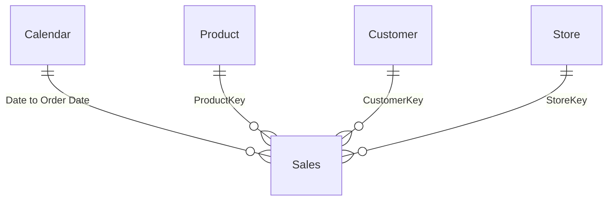

# sales

## Overview

This model supports sample retail sales analysis for report consumers and self-service analysts. It connects order lines to product, customer, store and calendar attributes. Measures cover sales amount, cost, monetary margin, units, row counts, new and returning customers, customers with sales and time comparisons.

The dependent [sales-overview report](sales-overview.report.md) uses these measures for summary cards, charts and an annual category matrix. The report names Northwind Retail Group, but the model sources workshop sample files and modifies some values during refresh. It is not evidence of certified company revenue.

| Property | Value |
|---|---|
| Source | `src/sales.SemanticModel` |
| Storage mode(s) | Import |
| Tables | 5 |
| Columns | 63: 53 visible, 10 hidden |
| Measures | 15 |
| Relationships | 4 |
| Hierarchies | 1, with 3 levels |
| Calculation groups | None |
| Compatibility level | 1702 |
| Culture / source query culture | en-US / en-GB |

## Model Structure



`Sales` is the central fact table. Each dimension has an active one-to-many relationship to it, with single-direction filtering from the dimension to sales. There are no inactive, bidirectional or many-to-many relationships in the definition.

| Dimension key | Sales key | Behavior |
|---|---|---|
| Calendar.Date | Sales.Order Date | Active; date dimension filters order dates, not delivery dates. |
| Product.ProductKey | Sales.ProductKey | Active; product selections filter sales lines. |
| Customer.CustomerKey | Sales.CustomerKey | Active; customer selections filter sales lines. |
| Store.StoreKey | Sales.StoreKey | Active; store selections filter sales lines. |

Because filters do not flow back from sales into dimensions, a date or store selection does not automatically reduce `# Customers` or `# Products`. Use `# Customers (w/ Sales)` for the customer count represented in filtered sales. Key uniqueness and unmatched fact keys were not checked against data.

`Calendar` is marked as a time table with `Date` as its key. Auto date/time is disabled, and implicit measures are discouraged. No calculation groups or perspectives are defined. DAX user-defined functions provide the PQL assertions and `Tests.Run` test suite. One en-US culture is defined.

## Tables and Columns

Types below reflect declared model metadata. Decimal means fixed decimal; date and time fields are stored as model Date/time values. Business descriptions explain the source and expressions, rather than asserting verified data quality.

### Calendar

One generated row per date from 2017-01-01 through 2021-12-31. It supplies order-date filtering and classic date-based time intelligence.

| Column | Data type | Visibility | Description |
|---|---|---|---|
| Day | Whole number | Visible | Day of month. |
| Month | Whole number | Visible | Calendar month number, 1 to 12. |
| Quarter | Text | Visible | Calendar quarter label, Q1 to Q4. |
| Year | Whole number | Visible | Calendar year. |
| Date | Date/time | Visible | Unique daily key, displayed as a date. |
| Month Name | Text | Visible | Abbreviated month name, sorted by Month. |
| Year-Month | Date/time | Visible | Month/year text converted to a date and displayed as `mmm yyyy`; used by the report trend. |
| Week Number | Whole number | Visible | Power Query week-of-year result; no explicit first-day rule is supplied. |
| Day of Week | Whole number | Visible | Power Query day-of-week result plus one; no explicit first-day rule is supplied. |
| Day Name | Text | Visible | Full weekday name, sorted by Day of Week. |
| Is Weekend | Boolean | Visible | True when the default-based `Date.DayOfWeek` index is at least five; verify the intended weekday convention before use. |
| Fiscal Year | Whole number | Visible | Calendar year plus one for July through December; unchanged for January through June. |
| Fiscal Quarter | Text | Visible | `FQ` plus integer division of month number plus five by three. This produces FQ2 through FQ5, not a conventional four-quarter fiscal cycle. |

The `Year-Month-Day` hierarchy contains **Year > Month > Day**, using the numeric columns, not `Month Name` or `Date`.

The calendar has fixed boundaries and does not extend at refresh. Sales outside its date range cannot be analyzed through matching calendar dates. Fiscal fields should not be assumed to implement the company's fiscal calendar.

### Sales

Intended grain: one order line, identified by Order Number and Line Number. Uniqueness was not verified. Quantities, net prices and time-of-day values are generated or modified during refresh.

| Column | Data type | Visibility | Description |
|---|---|---|---|
| Order Number | Whole number | Visible | Source order identifier; repeated across lines of an order. |
| Line Number | Whole number | Visible | Source line identifier within an order. |
| Order Date | Date/time | Hidden | Date linked to Calendar and used for sales time analysis. |
| Delivery Date | Date/time | Visible | Source delivery date; no relationship to Calendar is defined. |
| CustomerKey | Whole number | Hidden | Foreign key to Customer. |
| StoreKey | Whole number | Hidden | Foreign key to Store. |
| ProductKey | Whole number | Hidden | Foreign key to Product. |
| Unit Cost | Decimal | Hidden | Cost per unit used by Cost and Margin. |
| Currency Code | Text | Visible | Source currency code; measures do not apply currency conversion. |
| Exchange Rate | Decimal | Visible | Source exchange-rate value; direction and basis are unverified and no measure uses it. |
| Environment | Text | Visible | Value copied from the Environment refresh parameter. |
| Time | Date/time | Visible | Random hour and minute generated at refresh, displayed as time; not a verified transaction timestamp. |
| Quantity | Whole number | Hidden | Randomized units used by quantity and monetary measures. |
| Net Price | Decimal | Hidden | Randomized per-unit net price used by Sales Amount and Margin. |

The source Unit Price column is removed before loading. Sales measures use Net Price, not the current product list price.

### Product

Intended grain: one product per ProductKey. Product category and subcategory are flattened into this dimension.

| Column | Data type | Visibility | Description |
|---|---|---|---|
| Product | Text | Visible | Product name, renamed from the source Product Name. |
| ProductKey | Whole number | Hidden | Product key on the one side of the sales relationship. |
| Product Code | Text | Visible | Source business product code, distinct from the relationship key. |
| Manufacturer | Text | Visible | Product manufacturer, not necessarily its brand. |
| Brand | Text | Visible | Product brand used in report comparisons. |
| Color | Text | Visible | Source color attribute. |
| Weight Unit Measure | Text | Visible | Unit to interpret alongside Weight. |
| Weight | Decimal | Visible | Product weight; do not aggregate across incompatible units. |
| Unit Cost | Decimal | Visible | Product-record unit cost, distinct from the sales-line cost used in measures. |
| Unit Price | Decimal | Visible | Product-record unit price, not realized sales value. |
| Subcategory Code | Text | Visible | Source subcategory identifier. |
| Subcategory | Text | Visible | Product subcategory label. |
| Category Code | Text | Visible | Source category identifier. |
| Category | Text | Visible | Product category label. |

### Customer

Intended grain: one customer record per CustomerKey. Geography describes the customer, not the store. No loyalty tiers or lifecycle segments are defined.

| Column | Data type | Visibility | Description |
|---|---|---|---|
| CustomerKey | Whole number | Hidden | Customer key on the one side of the sales relationship. |
| Gender | Text | Visible | Source customer gender attribute used as a report series. |
| Customer | Text | Visible | Customer name, renamed from the source Name. |
| Address | Text | Visible | Customer address. |
| City | Text | Visible | Customer city. |
| State Code | Text | Visible | Customer state or region code. |
| State | Text | Visible | Customer state or region label. |
| Zip Code | Text | Visible | Postal code, retained as text. |
| Country Code | Text | Visible | Source country code, distinct from Country. |
| Country | Text | Visible | Customer country name. |
| Continent | Text | Visible | Customer continent label. |
| Birthday | Date/time | Visible | Source birth date. |
| Age | Calculated; inferred type unavailable offline | Visible | Year boundaries between Birthday and refresh-time TODAY(), not exact completed years of age. Displayed as a whole number. |

The source Age column is removed and replaced by this calculated column:

```dax
DATEDIFF(
    [Birthday],
    TODAY(),
    YEAR
)
```

As an Import calculated column, Age changes when recalculated during processing, not automatically on each report view.

### Store

Intended grain: one store record per StoreKey. Store geography and operating attributes support location comparisons; they do not automatically restrict sales to open stores.

| Column | Data type | Visibility | Description |
|---|---|---|---|
| StoreKey | Whole number | Hidden | Store key on the one side of the sales relationship. |
| Store Code | Text | Visible | Source business store code. |
| Country | Text | Visible | Store country, distinct from customer country. |
| State | Text | Visible | Store state or region. |
| Store | Text | Visible | Store name, renamed from the source Name. |
| Square Meters | Whole number | Visible | Store area in square meters; no sales-per-area measure is defined. |
| Open Date | Date/time | Visible | Source opening date. |
| Close Date | Date/time | Visible | Source closing date, when populated. |
| Status | Text | Visible | Source operating-status label; counts do not apply a status rule automatically. |

## Measures

All measures retain the current filter context unless stated otherwise. Sales measures respond to related dimension filters. Dimension row counts respond to filters reaching their own table, not sales-only filters.

Monetary measures use the display format `$ #,##0`; counts use `#,##0`. A display symbol does not establish a common reporting currency. No measure uses Exchange Rate, and Sales.Net Price has a euro display format. Cross-currency aggregation and the treatment of returns and discounts need confirmation.

### # Customers (w/ Sales)

Counts distinct customer keys in filtered sales, not all customer records or loyalty members. A customer appearing in multiple groups is counted once in each applicable group, so group counts need not add to the total. DISTINCTCOUNT can include a blank key and returns blank when there are no rows.

```dax
DISTINCTCOUNT('Sales'[CustomerKey])
```

### # New Customers

Counts customers whose first qualifying purchase falls in the current context. Its existing DAX uses `ALLSELECTED` on Customer and Calendar, clears the Calendar Date filter while finding first purchases, and applies customer/date lineage with `TREATAS` and `KEEPFILTERS`. Product, category, brand and other remaining filters still affect classification. This is not an unconditional lifetime-first-purchase count.

### # Returning Customers

Counts customers with sales who are not new in the same context. It reuses both existing customer measures and inherits their filter behavior. Earlier purchases in excluded brands or categories do not override the new-customer classification. A customer with first and later purchases in the same period is new only.

```dax
[# Customers (w/ Sales)] - [# New Customers]
```

The measure is visible in Sales, uses integer format `#,##0`, and has no display folder. No sales returns blank; sales from only new customers returns zero. Totals recalculate classification in their own filter context instead of summing daily or monthly returning counts.

For example, the verified customer 102075 fixture has sales on 2017-06-27 and 2019-12-04. With both dates selected, returning counts are zero and one on the date rows, but zero at the total because the period includes the first purchase.

### Sales Qty

Sums individual product units from sales lines after refresh-time randomization. This is not a count of orders or lines.

```dax
sum('Sales'[Quantity])
```

### Sales Amount

Sums quantity multiplied by net unit price for each filtered sales line. It uses randomized quantity and net price, with no explicit exchange-rate conversion or separate returns adjustment. Do not equate it with certified net revenue.

```dax
SUMX('Sales', 'Sales'[Quantity] * 'Sales'[Net Price])
```

### Sales Amount (LY)

Evaluates Sales Amount for the date selection shifted one year earlier, retaining other dimension filters. It returns a result only when current-period Sales Amount is strictly positive. A zero, negative or blank current period hides the prior-year result even if the earlier period has sales. Dates outside the fixed calendar limit the comparison.

```dax
IF ([Sales Amount] > 0, CALCULATE([Sales Amount], SAMEPERIODLASTYEAR('Calendar'[Date])))
```

### Sales Amount Avg per Day

Evaluates Sales Amount for each distinct selected calendar date and averages the nonblank daily results. Dates with no sales are omitted rather than treated as zero; explicit zero results are included. This is not necessarily total sales divided by every day in the selected range.

```dax
AVERAGEX(VALUES('Calendar'[Date]), [Sales Amount])
```

### Margin

Sums quantity multiplied by the difference between net unit price and sales-line unit cost. This is a monetary margin, not a margin percentage or net profit after operating expenses. It uses sales-line values, not the current product cost.

```dax
SUMX (
    Sales,
    Sales[Quantity]
        * ( Sales[Net Price] - Sales[Unit Cost] )
)
```

### # Sales

Counts filtered sales-table rows. At the intended grain this counts order lines, not distinct orders, baskets or units.

```dax
COUNTROWS('Sales')
```

### Sales Amount (12M average)

Anchors a trailing 12-month date window at the latest selected calendar date. Within that window, it averages nonblank daily Sales Amount results, retaining non-date filters. It does not average monthly totals or require 12 complete months of history.

The guard compares the window's earliest date with the latest sales order date in the original context. This is not a complete-history check. Calendar boundaries and existing filters can limit available dates.

```dax
VAR v_selDate =
    MAX ( 'Calendar'[Date] )
VAR v_period =
    DATESINPERIOD ( 'Calendar'[Date], v_selDate, -12, MONTH )
VAR v_result =
    CALCULATE ( AVERAGEX ( VALUES ( 'Calendar'[Date] ), [Sales Amount] ), v_period )
VAR v_firstDate =
    MINX ( v_period, 'Calendar'[Date] )
VAR v_lastDateSales =
    MAX ( Sales[Order Date] )
RETURN
    IF ( v_firstDate <= v_lastDateSales, v_result )
```

### Sales Amount (6M average)

Uses the same daily-average calculation and sales-date guard as the 12-month measure, but over a trailing six-month window. Blank daily results are omitted. It is not a six-month average of monthly totals.

```dax
VAR v_selDate =
    MAX ( 'Calendar'[Date] )
VAR v_period =
    DATESINPERIOD ( 'Calendar'[Date], v_selDate, -6, MONTH )
VAR v_result =
    CALCULATE ( AVERAGEX ( VALUES ( 'Calendar'[Date] ), [Sales Amount] ), v_period )
VAR v_firstDate =
    MINX ( v_period, 'Calendar'[Date] )
VAR v_lastDateSales =
    MAX ( Sales[Order Date] )
RETURN
    IF ( v_firstDate <= v_lastDateSales, v_result )
```

Neither rolling model measure is used by the current report. Its trend instead contains a separate visual calculation, documented in the [report](sales-overview.report.md).

### Cost

Sums filtered sales-line quantity multiplied by sales-line unit cost. It is a product cost amount, not all operating costs. Randomized quantity affects the result.

```dax
SUMX ( Sales, Sales[Quantity] * Sales[Unit Cost] )
```

### # Products

Counts product dimension rows in context, not products sold. Date and customer filters reaching only Sales do not reduce it through the single-direction relationships.

```dax
COUNTROWS('Product')
```

### # Customers

Counts customer dimension rows in context, not customers with purchases. Use # Customers (w/ Sales) for transaction-based customer coverage.

```dax
COUNTROWS('Customer')
```

### # Stores

Counts store dimension rows in context. It does not automatically exclude closed stores or count only stores with sales.

```dax
COUNTROWS('Store')
```

## Security

No local security roles, row-level filters or object-level security permissions were found. Hidden keys and helper columns are usability settings, not access controls. Customer name, address and birthday fields remain visible; this document includes no customer records or role membership.

Workspace permissions, service role assignments and deployed security were not inspected. No country-level access restriction can be inferred from this local model.

## Data Sources and Refresh

See the [consolidated data-source inventory](data-sources.md) for all semantic-model sources.

There are five Import partitions, each using Power Query M. The four CSV imports use Web.Contents, UTF-8 comma-delimited parsing, promoted headers and explicit type conversions.

| Table | Partition | Source / behavior |
|---|---|---|
| Calendar | Calendar-c9bc757b-0dad-4b99-8287-18a451a3c5c3 | Generated date list, 2017-01-01 to 2021-12-31. |
| Sales | Sales-ddb4c40b-46fd-49ea-9a19-16e7e640a21a | `RAW-Sales.csv`; modifies quantity/net price and adds random Time and Environment. |
| Product | Product-171f48b3-e0ea-4ea3-b9a0-c8c673eb0648 | `RAW-Product.csv`; renames Product Name to Product. |
| Customer | Customer-3757b886-e26c-4cec-a550-cdeea37b94d4 | `RAW-Customer.csv`; renames Name to Customer and removes source Age. |
| Store | Store-c0e5ba98-f95a-4712-91ec-71c7dc35e177 | `RAW-Store.csv`; renames Name to Store. |

### Shared Parameters

| Parameter | Current definition | Effect |
|---|---|---|
| HttpSource | `https://raw.githubusercontent.com/RuiRomano/workshop-fabcon-26-bcn/main/resources/sample-data/` | Required text base URL for all four CSV imports. |
| Environment | `DEV`, with suggested values DEV, QUAL and PRD | Adds an environment label to Sales; the query does not use it to switch the source URL. |
| Randomizer | `0.6` | Required numeric input controlling sales quantity and net-price randomization. |

For positive source values, the randomization expressions generally choose between a lower bound based on `value * (1 - Randomizer)`, floored at one, and an upper bound capped at the original value. Quantity is rounded down; net price is rounded to three decimal places. They do not implement a symmetric plus/minus variation. Edge inputs and refresh results were not tested.

Repeated refreshes can change sales results even if the CSVs are unchanged. Time contains a generated hour and minute, not a source transaction time. Customer Age is recalculated from Birthday during processing.

No incremental-refresh policy or refresh schedule is present in the inspected model definition. A service schedule, credentials and gateway configuration were not inspected. Calendar month text conversion and weekday logic depend on parsing/default conventions and need runtime verification.

## Existing Deviations and Inspection Limits

The star schema and hidden relationship keys follow the team structure rules. The returning-customer measure follows existing customer-measure naming and placement. Visible numeric fields such as Product.Unit Price, Product.Unit Cost, Product.Weight, Sales.Exchange Rate and Store.Square Meters do not have corresponding explicit measures and hidden base columns. No unrelated objects were renamed or changed to address these deviations.

The original documentation inspection was offline. The returning-customer implementation was subsequently loaded locally, deployed to `RR - PBI Factory {dev}`, refreshed and tested on 2026-10-30. Its live metadata reports Ready, Int64, visible, format `#,##0` and a populated description. Key uniqueness, inferred Age type and deployed security were not tested in this change. The diagram describes declared relationships, not tested referential integrity. The original company-context file is unavailable, so company-specific revenue and fiscal definitions remain unconfirmed.

## Customer Classification Tests

The [returning-customer spec](../specs/returning-customers-202610.md) defines the approved behavior. [Tests.Run](../../src/sales.SemanticModel/definition/functions.tmdl) now has 36 assertions: the original four remain unchanged and 32 cover returning customers, supporting fixtures and reconciliation.

Run `python scripts\test-data.py` from the repository root against the configured development workspace. All 36 assertions returned boolean true after deployment and refresh. Coverage includes single-brand first and repeat purchases, selected and excluded brands/categories, multiple same-day rows, periods containing first and later purchases, non-contiguous date selections, blank versus zero, and date/month/customer/category-brand rows and totals.

An independent per-customer first-sale calculation matched the returning measure across 2,815 grouped results, including totals: 725 date rows, 1,974 customer rows, five year rows and 111 year/category/brand rows. Both reused measures matched their pre-change baseline in all five year/total rows and eight fixture scopes.

Local BPA ran with `& .\scripts\bpa\bpa.ps1 -src @('.\src')` against the model and report using the repository rule files. It exited zero with 72 existing severity-2 `PROVIDE_DESCRIPTIONS_FOR_TABLES_MEASURES_AND_COLUMNS` warnings across five tables, 14 existing measures and 53 visible columns. The returning measure had no violations. Report definitions were unchanged; the repository deployment script republished the existing report alongside the model.
